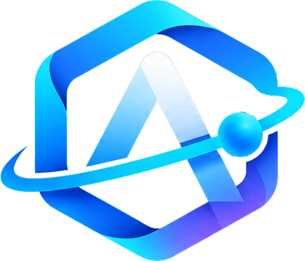
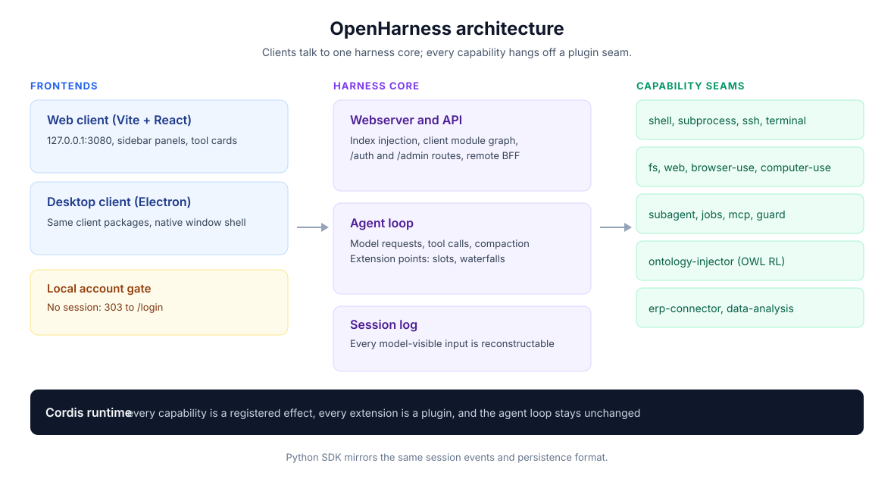
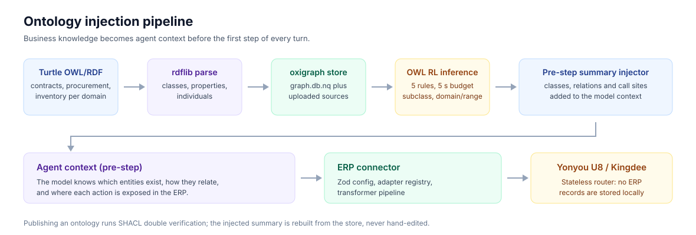
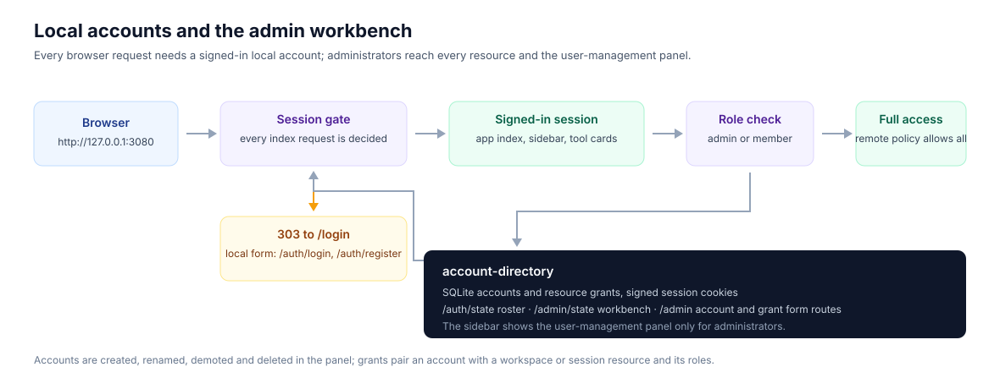

# Ontology OpenHarness

English | [中文](README.zh.md)

<p align="center">
  
  <br />
  <strong>Ontology OpenHarness</strong>
</p>

<p align="center">

[](https://nodejs.org/) [](https://pnpm.io/) [](https://www.typescriptlang.org/) [](LICENSE) [](https://github.com/jeokeo011222/Openharness/pulls) [](https://github.com/jeokeo011222/Openharness/stargazers)

</p>

<p align="center">

**A plugin-first agent harness with ontology-powered context injection, ERP connectors, and local account administration.**

</p>

---

## ✨ Why OpenHarness

Every agent is context-limited. OpenHarness gives the agent a **business ontology it can act through** rather than only read: Turtle OWL/RDF parsed into class and property summaries for the prompt, object types bound to real rows so the model can query them, and declared actions it may only *propose* — a human approves before anything is written.

Around that core sits a plugin-first runtime: clients, tools, storage, and model providers are effects registered on documented seams, so a new capability is a new plugin instead of a new branch in the agent loop.

## 🧭 Architecture at a glance

<p align="center">
  
</p>

One request crosses three layers, and nothing in the middle special-cases the ends:

- **Frontends** — the Vite + React Web client at `http://127.0.0.1:3080` and the Electron desktop shell share a single set of client packages: sidebar panels, tool cards, and settings are slot contributions.
- **Harness core** — the webserver and API inject the client module graph and serve the `auth` and `admin` routes, the agent loop owns model requests and tool calls, and the session log keeps every model-visible input reconstructable.
- **Capability seams** — shell, filesystem, web search, subagents, jobs, MCP, the ontology injector, the ERP connector, and the data-analysis bundle all attach without touching the loop.

## 🔥 Core features

| Capability | What it does |
|------------|--------------|
| 🧩 **Plugin-First Architecture** | Every seam — slots, waterfall listeners, services, projections — is a registered effect. No agent-loop code changes to extend behavior. |
| 🔐 **Local Accounts** | Every browser request needs a signed-in local account; there is no platform account to link. Accounts, roles, and per-resource grants live in a SQLite directory. |
| 👑 **Admin Workbench** | An admin role bypasses resource policy and adds a user-management panel to the sidebar: create, rename, reset, promote, and delete accounts, then grant `owner`/`author`/`reviewer`/`publisher`/`viewer` roles per workspace or session. |
| 📚 **Ontology Injector** | Parse Turtle OWL/RDF per business domain (contracts, procurement…), summarize classes and properties, and inject the summary into the agent context at pre-step. |
| 🧱 **Bound objects** | Object types bind to CSV or REST sources with a declared primary key and field map. A sync is one transaction and keeps its run history, so the model queries objects instead of guessing at tables. |
| ⚡ **Declared actions** | Each action lists its parameters, declarative preconditions, and effects. The model proposes; a human approves; only then does the commit run — and the preconditions are re-checked at commit time. |
| 🔌 **ERP Connector** | A standalone Node router with Zod schemas, an adapter registry, and a transformer pipeline, shipping skeletons for **Yonyou U8 (v13/v15)** and **Kingdee Cloud Galaxy**. |
| 🖥️ **Mapping Editor** | A React + Vite visual editor that pairs ontology actions with ERP API mappings, with inline transformer specs and a live JSON preview. |
| 📊 **Data Analysis Bundle** | The `dsh-data-analysis` profile bundle adds analysis tools to the Web client and declares its own sidebar panel, so the capability installs as a bundle patch. |
| 🧭 **Dual UI** | Web and Desktop frontends share one client package set, so a panel written once renders in both shells. |
| 🐍 **Python SDK** | A session-projected mirror of the TypeScript loop — the same `SessionEventMap`, the same expected outputs, and the same persistence format. |
| 🛡️ **Safety First** | Plugin-level sandboxing, a credential boundary, versioned session formats, structural validation before an ontology version is published, and an explicit safety notice before the first run. |

## 📚 Ontology injection pipeline

<p align="center">
  
</p>

Business knowledge is compiled once and read on every turn: published ontologies are verified, stored as an RDF graph, and summarized into the prompt before the first model step.

- **Sources are ordinary files** — each business domain keeps its Turtle OWL/RDF documents next to the project, and an upload publishes them into the graph store after structural validation.
- **The store is the single truth** — `oxigraph` holds `graph.db.nq` plus uploaded sources, and the injected summary is rebuilt from the store on each request instead of being hand-edited.
- **Writes need a human** — a proposal records the before/after of every field it would change, every blocking precondition, and the linked objects it touches. No tool can approve one.

## 🔐 Local accounts and the admin workbench

<p align="center">
  
</p>

Access is decided before any page is rendered: the browser gets the application only with a signed local session, and administrators additionally get a management surface that every other account lacks.

- **The gate is unconditional** — without a valid session cookie the index answers `303` to `/login`; `/auth/login` and `/auth/register` are the only local forms, and the former DeepSeek platform sign-in is gone.
- **The directory owns identity** — accounts, roles, and grants live in SQLite behind signed cookies; `/auth/state` reports the current session and `/admin/state` reports the roster that the workbench renders.
- **Admin means every resource** — the remote access policy exempts the admin principal from resource checks, and the client adds the user-management panel to the sidebar only when the session carries that role.

## 🚀 Quick start

### Prerequisites

- Node.js ≥ **24.9.0**
- pnpm ≥ **11.28**

### Install & Run

```sh
git clone https://github.com/jeokeo011222/Openharness.git
cd Openharness
pnpm install
pnpm run build
pnpm run dev:web          # http://127.0.0.1:3080
```

One-command alternative if you already have a key:

```sh
DEEPSEEK_API_KEY=... pnpm dsh web
```

The first browser visit lands on `/login`; register an account there, or sign in with the administrator credentials configured in your profile's `cordis.patch.yml`.

## 📂 Monorepo layout

```
Openharness/
├── apps/
│   ├── web/              # Vite + React web client
│   └── desktop/          # Electron desktop wrapper
├── packages/             # 50+ workspace packages, grouped by concern
│   ├── core/             # Agent/session API
│   ├── llm/              # Model providers
│   ├── shell/ | subprocess/ | ssh/ | terminal/
│   ├── fs/ | web/ | browser-use/ | computer-use/
│   ├── identity/         # Local account directory (SQLite) + admin routes
│   ├── ontology-injector/   # OWL/RDF → agent context + inference
│   ├── ...               # subagent, compaction, guard, session, mcp…
│   └── experimental/     # capabilities without product-support commitment
├── data-analysis/        # Root-level dsh-data-analysis profile bundle
├── erp-connector/        # Standalone ERP router package (Yonyou / Kingdee adapters)
├── erp-mapping-editor/   # React + Vite visual mapping editor
├── ontology-store/       # Embedded RDF graph database (graph.db.nq) + uploaded sources
├── vendor/               # Vendored Cordis source
├── native/               # Node addon system
└── website/              # VitePress documentation
```

## 🛠️ Built with

- [Cordis](https://github.com/cordiverse/cordis) — spatiotemporal composability runtime
- [TypeScript](https://www.typescriptlang.org/) `strict: true`, ESM everywhere
- [oxigraph](https://github.com/oxigraph/oxigraph) — embedded RDF graph database holding ontologies
- [rdflib](https://github.com/linkeddata/rdflib.js) — embedded RDF/OWL parser for the Turtle vocabulary
- [Zod](https://zod.dev/) + [Schemastery](https://github.com/cordiverse/schemastery) — config validation
- [Vite](https://vite.dev/) + [Electron](https://www.electronjs.org/) — dual-frontend stack
- [pnpm workspaces](https://pnpm.io/workspaces) — monorepo

## ❓ FAQ

**Q: Is OpenHarness production-ready?** It is a developer preview: public APIs are pre-stable and versions can break between releases, so read the matching upgrade guide before upgrading.

**Q: Which model providers are supported?** Any provider with an OpenAI-compatible endpoint works through the DeepSeek SDK surface; native providers and remote BFF adapters live in `packages/llm/`.

**Q: Can I use OpenHarness without the ontology or ERP features?** Yes — the ontology injector and the ERP connector are optional plugins. The base harness ships the plugin-first agent/session primitives and the full dual UI stack.

**Q: Where does my ERP data live?** OpenHarness stores no ERP records. The connector is a stateless router that delegates to configured adapters, and credentials stay in local `cordis.yml` overlays that are never committed.

## 🏷️ Keywords

Agent harness · Ontology (OWL/RDF) · Knowledge graph · ERP connector · Yonyou U8 · Kingdee · Ontology actions · MCP · Plugin architecture · TypeScript · Electron · Web UI · Local accounts · RBAC · SQLite · Python SDK

## 🤝 Contributing

See [CONTRIBUTING.md](CONTRIBUTING.md) for development conventions, gates, and the plugin authoring guide. Plugins, adapters, and documentation fixes are all welcome.

> Every new plugin declaration goes through `ctx.effect()`; every capability is a service definition, a service provider, and a consumer — never a hidden singleton.

## 📄 License

[MIT](LICENSE)

Third-party dependencies and their licenses are disclosed in [THIRD_PARTY_NOTICES.md](THIRD_PARTY_NOTICES.md).
