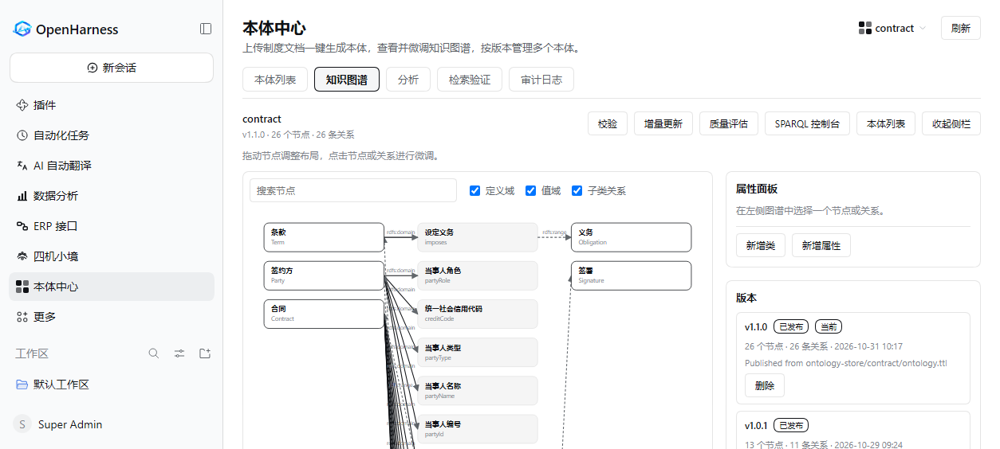
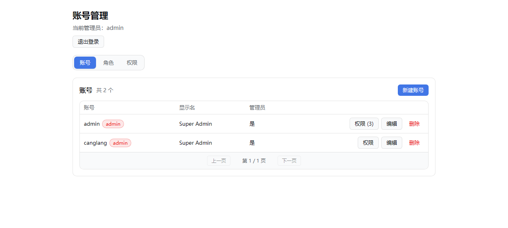
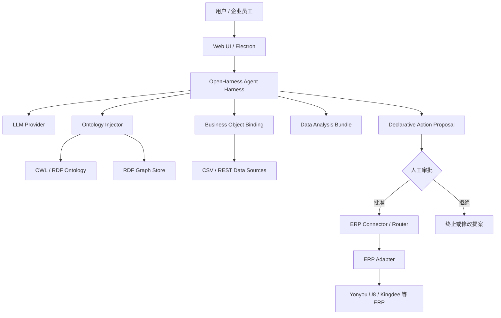
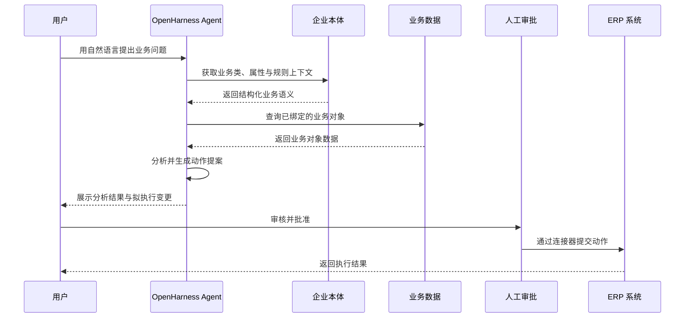

<div align="center">

# Ontology OpenHarness

[English](README.md) | 中文

### 让 AI 真正理解企业，而不只是连接企业数据。

**An Ontology-Driven Enterprise Agent Harness**

以企业本体为语义底座，以 Agent Harness 为运行内核，以数据分析和 ERP 连接为业务执行入口。

[](./LICENSE)
[](https://nodejs.org/)
[](https://pnpm.io/)
[](https://www.w3.org/RDF/)

[快速开始](#-快速开始) · [核心能力](#-核心能力) · [系统架构](#-系统架构) · [参与贡献](#-参与贡献)

</div>

---

## 🌐 OpenHarness 是什么？

企业并不缺少数据，也不缺少软件系统。真正困难的是：**让 AI 理解这些数据代表什么、业务对象之间有什么关系、业务规则如何约束操作，以及如何安全地把分析结果转化为业务行动。**

OpenHarness 是一个基于 DeepSeek Harness 扩展构建的、以插件为核心的企业级 Agent Harness。它将企业本体（Ontology）、数据分析能力和 ERP 连接能力整合到统一的智能体运行环境中，帮助 AI 从“理解自然语言”进一步走向“理解企业业务”。

OpenHarness 不只是一个聊天界面，也不只是一个 ERP API 包装层。它尝试建立一条完整的企业智能链路：

**企业知识建模 → 业务语义注入 → 数据对象绑定 → 智能分析 → 动作提议 → 人工审批 → 业务系统执行**

> **核心理念：让 AI 从“知道企业有什么数据”，进化到“理解企业如何运作”。**

## ✨ 为什么是 Ontology-Driven？

传统 AI 应用通常通过提示词、文档检索或数据库 Schema，让模型间接了解企业。但这些方式很难稳定表达复杂业务中的对象类型、属性约束、对象关系和操作规则。

OpenHarness 引入 OWL/RDF 企业本体，将业务知识组织为机器可解析的语义结构，并在 Agent 执行过程中提供上下文。

| 传统方式 | OpenHarness 的本体驱动方式 |
|---|---|
| 让模型从表名、字段名猜测业务含义 | 用本体明确描述业务类、属性与语义 |
| 依赖零散文档解释业务规则 | 将业务知识组织为可校验的 OWL/RDF 图 |
| 模型直接面对数据库表结构 | 将业务对象类型绑定到真实数据源 |
| 模型生成 SQL 或 API 调用后直接执行 | 先形成声明式动作提案，再经过审批与校验 |
| 每个新功能都可能侵入 Agent 主循环 | 通过插件扩展工具、服务、界面与数据能力 |

**本体不是一段更长的 Prompt。** 它是企业业务语义的结构化表达，也是连接自然语言、数据对象与业务动作的中间层。

## 🚀 核心能力

### 1. 企业本体引擎（Ontology Engine）

将企业业务知识转化为 Agent 可以理解和使用的结构化语义上下文。

- 支持 Turtle 格式的 OWL/RDF 本体文件。
- 解析业务类、属性及其语义描述。
- 按业务领域组织本体，例如合同、采购等。
- 将本体摘要注入 Agent 上下文，减少模型对业务含义的猜测。
- 通过 RDF 图存储本体，并从存储结果重建注入摘要。
- 本体发布前执行结构校验。



### 2. 业务对象绑定（Business Object Binding）

让本体中的业务对象与真实数据建立联系。

- 对象类型可绑定 CSV 或 REST 数据源。
- 声明主键与字段映射。
- 将数据映射为具有业务语义的对象，而不是让模型直接猜测数据库表。
- 同步过程以事务方式执行，并保留运行历史。

### 3. 声明式业务动作（Declarative Business Actions）

让 Agent 不只回答“应该怎么做”，还能够提出结构化的业务操作方案。

- 声明动作参数、前置条件与预期影响。
- Agent 负责理解意图并生成动作提案。
- 提案记录变更前后值、阻断条件及关联对象。
- 写操作需要人工审批。
- 提交时重新检查前置条件，降低业务状态变化带来的风险。

**设计原则：AI 可以提出行动，但不能绕过授权替人批准。**

### 4. ERP 连接层（ERP Integration）

为企业本体动作与 ERP 系统之间建立可扩展的连接机制。

- 独立 ERP Router，降低 ERP 接口与 Agent 核心之间的耦合。
- 基于 Schema 的配置校验。
- 适配器注册机制，便于扩展不同 ERP 厂商和版本。
- Transformer 管道用于业务字段与接口数据转换。
- 当前仓库包含用友 U8（v13/v15）与金蝶云·星空适配器骨架。
- 提供可视化映射编辑器，将本体动作与 ERP API 映射关联，并支持转换配置和 JSON 预览。

> ERP 适配器的实际可用范围取决于对应版本的接口实现、部署环境与企业侧配置。请勿将适配器骨架理解为对所有 ERP 功能的完整覆盖。

### 5. 企业数据分析（Data Analysis）

将数据分析能力作为可安装的能力包接入 Agent 工作环境。

- 通过 `dsh-data-analysis` profile bundle 扩展分析工具。
- 在 Web 客户端中提供对应的分析入口和侧边栏面板。
- 采用插件化方式集成，避免将分析功能硬编码进 Agent 主循环。
- 可与本体业务语义结合，为面向业务对象的数据分析提供基础。

### 6. 企业用户与权限管理（Identity & RBAC）

提供本地账号体系与管理员工作台。

- 本地账号、角色和资源授权存储于 SQLite。
- 浏览器访问需要有效的本地登录会话。
- 管理员可在工作台中管理用户及授权。
- 支持按工作区或会话分配 `owner`、`author`、`reviewer`、`publisher`、`viewer` 等角色。
- 管理界面根据当前会话角色展示相应能力。



### 7. Web + Desktop 双端体验

- Web 客户端基于 Vite + React。
- Electron 提供桌面应用外壳。
- 两端共享客户端包，面板、工具卡片和设置项通过扩展点贡献。
- 能力模块可在统一的 Agent 运行环境中复用。


### 8. 可扩展的 Agent Harness

OpenHarness 延续插件优先的架构理念。模型提供方、工具、存储、客户端和业务能力通过明确的扩展点注册。

新增能力优先采用插件或能力包实现，尽量避免修改 Agent Loop 本身。

---

## 🧭 系统架构

一次企业任务可以抽象为以下链路：



### 三层架构

| 层次 | 主要职责 |
|---|---|
| 交互层 | Web、Desktop、登录认证、管理员工作台、工具与业务面板 |
| Agent Harness 层 | 模型调用、Agent Loop、会话管理、工具执行、上下文注入与权限边界 |
| 企业能力层 | 本体引擎、业务对象绑定、数据分析、声明式动作、ERP 连接器 |

### 本体驱动的业务执行链



## 🧠 一个典型场景

假设企业员工提出：

> “帮我检查本月待处理采购合同，找出金额异常或审批信息不完整的记录，并准备需要补充的信息。”

在具备相应本体、数据绑定和工具配置的情况下，OpenHarness 可以沿着以下路径工作：

1. **理解业务概念**：通过采购合同本体识别合同、供应商、金额、审批状态等业务概念。
2. **定位业务对象**：根据对象绑定配置查询真实业务记录。
3. **执行数据分析**：识别异常金额、缺失字段或不完整的业务信息。
4. **生成分析结果**：以业务语义组织结果，而不是只返回一堆数据库字段。
5. **准备业务动作**：在需要修改业务数据时，生成包含参数、前置条件和预期影响的动作提案。
6. **人工审核**：由有权限的人员检查并批准。
7. **连接 ERP**：通过配置好的 ERP 适配器执行获批操作。

这是一种架构工作流示例。实际可执行范围取决于已发布的本体、数据源、ERP 适配器和权限配置。

## 🔐 安全与治理设计

企业级 AI 不仅需要能力，还需要明确的执行边界。

OpenHarness 在当前实现中包含以下设计：

- **本地身份体系**：账号和授权由本地目录管理。
- **资源级角色授权**：按工作区或会话控制不同角色的访问范围。
- **动作审批机制**：Agent 提出写操作，人工审批后才能提交。
- **提交前重新校验**：执行阶段重新检查动作前置条件。
- **凭据边界**：ERP 凭据保存在本地配置覆盖层中，不应提交到代码仓库。
- **本体结构校验**：本体发布前执行结构检查。
- **会话可重建性**：保留模型可见输入与会话事件，便于检查执行过程。

> 安全能力仍需结合实际部署方式、网络边界、密钥管理、备份策略和企业权限制度进行整体评估。上线前请阅读项目安全说明，并在隔离环境中完成测试。

## 🧰 技术栈

| 领域 | 技术 |
|---|---|
| Agent Runtime | DeepSeek Harness / Cordis |
| 主要开发语言 | TypeScript（strict mode） |
| 本体表达 | OWL / RDF / Turtle |
| RDF 图存储 | Oxigraph |
| RDF 解析 | rdflib |
| 配置与结构校验 | Zod / Schemastery |
| Web UI | Vite / React |
| Desktop | Electron |
| 本地身份与权限数据 | SQLite |
| Python 能力 | Python SDK |
| Monorepo | pnpm workspaces |

## 📦 仓库结构

```text
OpenHarness/
├── apps/
│   ├── web/                  # Web 客户端
│   └── desktop/              # Electron 桌面端
├── packages/                 # Agent Harness 与扩展能力包
│   ├── core/                 # Agent / Session 核心
│   ├── llm/                  # 模型提供方
│   ├── identity/             # 本地账号、角色与管理路由
│   ├── ontology-injector/    # OWL/RDF 本体上下文注入
│   └── ...                   # 工具、会话、MCP 等扩展
├── ontology-store/           # RDF 图存储
├── ontology-rag/             # 本体相关检索能力
├── data-analysis/            # 数据分析能力包
├── erp-connector/            # ERP Router 与适配器
├── erp-mapping-editor/       # ERP 映射编辑器
├── erp-workbench/            # ERP 工作台
├── python/                   # Python 相关能力
├── docs/                     # 项目文档
├── website/                  # 文档网站
└── native/                   # Native 扩展
```

## 🚀 快速开始

### 环境要求

- Node.js `>= 24.9.0`
- pnpm `>= 11.28`

### 1. 克隆项目

```bash
git clone https://github.com/jeokeo011222/OpenHarness.git
cd OpenHarness
```

### 2. 安装依赖

```bash
pnpm install
```

### 3. 构建项目

```bash
pnpm run build
```

### 4. 启动 Web 开发环境

```bash
pnpm run dev:web
```

默认访问地址：

```text
http://127.0.0.1:3080
```

### 5. 配置模型

根据所使用的模型提供方配置相应 API Key 和模型参数。若使用 DeepSeek API，可按项目配置方式提供 `DEEPSEEK_API_KEY`。

```bash
DEEPSEEK_API_KEY=your_api_key pnpm dsh web
```

首次访问 Web UI 时，按页面提示注册本地账号，或使用项目 profile 中配置的管理员凭据登录。

> 具体配置项请以当前分支的配置文件和文档为准。请勿将 API Key、ERP 密码或其他生产凭据提交到 Git。

## 🗺️ 项目方向

OpenHarness 希望探索一条更适合企业场景的 Agent 技术路线：

1. **从 Prompt Engineering 走向 Ontology Engineering**：让企业业务知识拥有结构化、可校验、可复用的表达。
2. **从 RAG 走向 Semantic Context**：不只检索相关文本，还要让业务对象、属性与关系参与 Agent 推理。
3. **从数据问答走向业务对象智能**：让模型围绕企业对象开展分析，而不是只面对孤立的数据表。
4. **从工具调用走向受治理的业务动作**：把动作参数、前置条件、审批和执行边界纳入统一流程。
5. **从单体 Agent 走向可组合的企业能力平台**：通过插件扩展模型、工具、数据、ERP 与交互界面。

我们的长期目标是让企业能够逐步构建自己的**可理解、可连接、可治理、可扩展的 AI 业务运行环境**。

## ⚠️ 项目状态

OpenHarness 当前处于持续开发与验证阶段。部分接口、插件和 ERP 适配能力可能继续演进，版本升级也可能带来兼容性变化。

- 请在测试环境中验证功能，再评估生产部署。
- ERP 连接能力取决于具体适配器实现和企业接口权限。
- 不要在未经审批的情况下开放高风险业务写操作。
- 请阅读仓库中的安全说明、贡献指南和第三方依赖声明。

## 🤝 参与贡献

欢迎对企业本体、Agent Harness、数据分析、ERP 适配器、权限治理和开发者体验感兴趣的开发者参与。

你可以通过以下方式贡献：

- 提交 Issue，反馈问题或提出功能建议。
- 提交 Pull Request，改进代码、文档或测试。
- 开发新的本体领域模型或数据源适配器。
- 扩展 ERP Adapter 与数据转换器。
- 完善示例、测试用例和部署文档。

开始之前，请阅读仓库中的 `CONTRIBUTING.md`。

## 🙏 致谢

OpenHarness 的构建和运行站在多个优秀开源项目的肩膀上：

- **[DeepSeek](https://www.deepseek.com/)** — 开源模型与 API，支撑 OpenHarness 日常开发与验证。
- **[Cordis](https://github.com/cordiverse/cordis)** — 时空可组合运行时，Agent Harness 的插件架构底座。
- **[Oxigraph](https://github.com/oxigraph/oxigraph)** — 嵌入式 RDF 图数据库，承载企业本体存储。
- **[rdflib](https://github.com/linkeddata/rdflib.js)** — Turtle / OWL / RDF 解析，本体文件的加载与校验。

感谢以上项目的维护者与贡献者，以及每一位参与构建开源 AI Agent 生态的开发者。

## 📄 License

本项目采用 [Apache License 2.0](./LICENSE)。第三方依赖及其许可证信息请参阅 `THIRD_PARTY_NOTICES.md`。

---

<div align="center">

**OpenHarness — Give AI a Model of Your Business.**

让 AI 理解企业，让数据产生业务语义，让智能连接真实业务。

如果 OpenHarness 对你有帮助，欢迎 Star ⭐、Fork 和参与共建。

</div>
