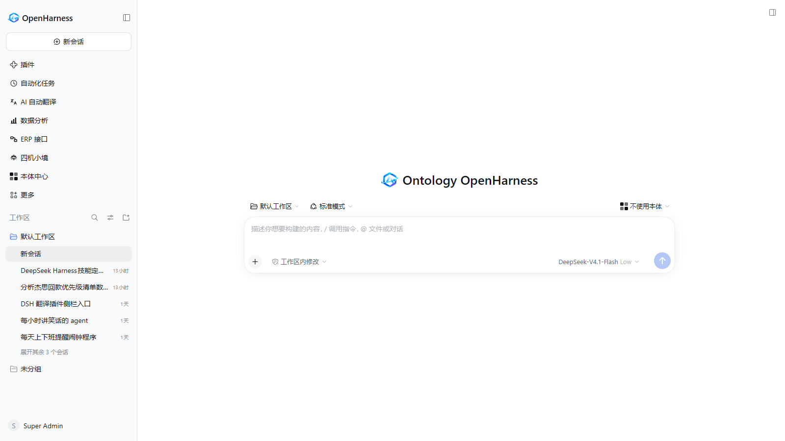
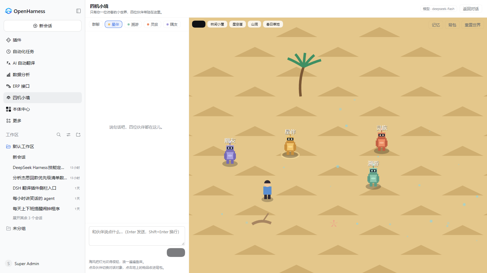
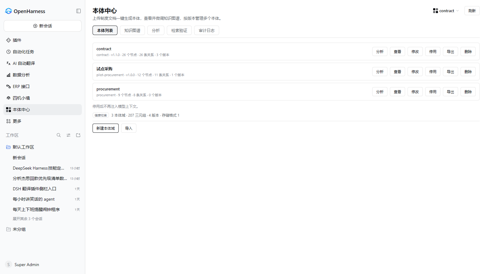
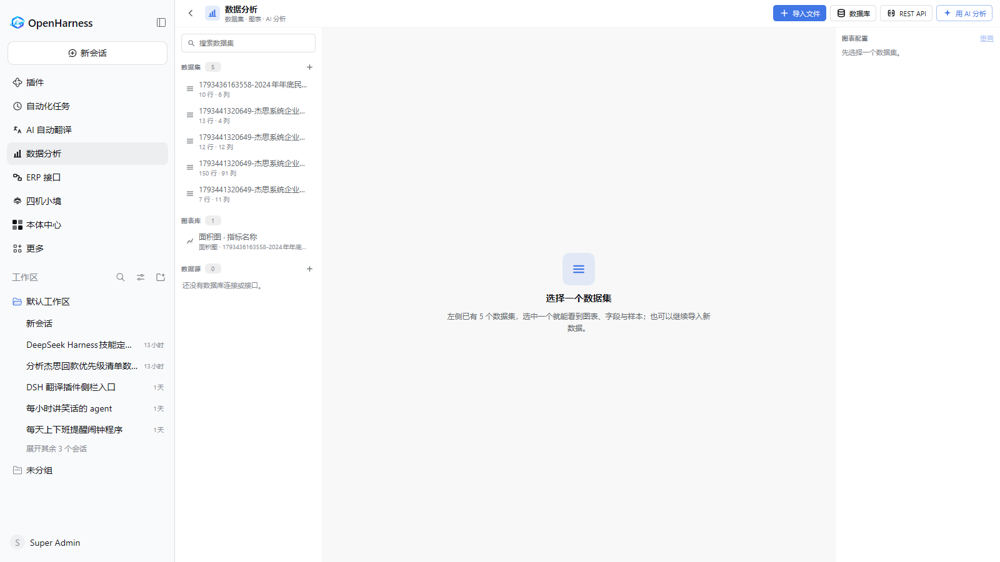
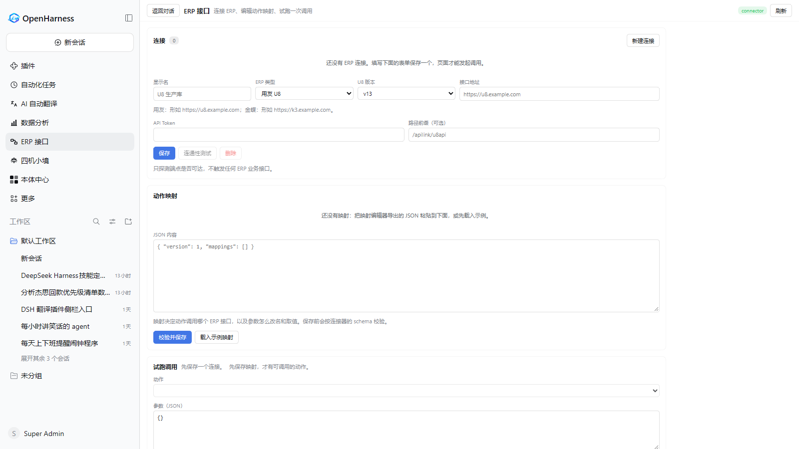
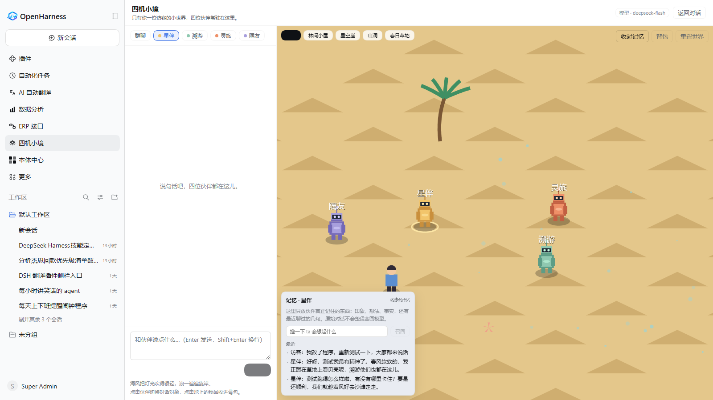

# Ontology OpenHarness

[English](README.md) | 中文

<p align="center">
  
  <br />
  <strong>Ontology OpenHarness</strong>
</p>

<p align="center">

[](https://nodejs.org/) [](https://pnpm.io/) [](https://www.typescriptlang.org/) [](LICENSE) [](https://github.com/jeokeo011222/Openharness/pulls) [](https://github.com/jeokeo011222/Openharness/stargazers)

</p>

<p align="center">

**一套企业级、本体驱动的智能体运行时：业务知识变成可执行的上下文，表格与数据库变成同一个分析工作台，主流 ERP 变成可调用的接口——而且全部跑在你完全掌控的本地账号体系里。**

</p>

<p align="center">
  
  
</p>

---

## ✨ 为什么选择 OpenHarness

每一个智能体都受限于上下文窗口。**本体 OpenHarness** 给智能体的不只是一份可读的业务知识，而是一套**可通过它做事的本体**：Turtle 语法的 OWL/RDF 被解析为类与属性摘要供提示词使用；对象类型绑定到真实数据行，模型因此能查询对象；动作被声明出来，而模型只能「提议」——写操作必须由人批准。

内核之外是一套插件优先的运行时：客户端、工具、存储与模型提供方都是注册在既定扩展点上的 effect，新增能力 = 新增插件，而不是在智能体循环里再加一个分支。

## 🏭 企业本体驱动

<p align="center">
  
</p>

业务知识只编译一次，却会在每一轮被读取：发布的本体先通过校验，再以 RDF 图的形式存储，并在第一个模型步骤之前被汇总进提示词。

- **源文件就是普通文件** — 每个业务域把自己的 Turtle OWL/RDF 文档放在项目里，上传后经结构校验写入图数据库。
- **图数据库是唯一事实来源** — `oxigraph` 持有 `graph.db.nq` 与上传的源文件，注入摘要每次请求都由图数据库重建，不靠手工编辑。
- **写操作必须有人** — 一份提案记录它要改的每个字段的前后值、每一条未满足的前置条件，以及受影响的关联对象。没有任何工具能替人批准。

下面这条流水线就是一次请求与你的本体相遇的全过程——解析、入库、推理、注入，然后才轮到经人批准的动作去调 ERP：

<p align="center">
  
</p>

仓库随附可直接运行的业务场景 Turtle 文档与对象绑定——合同、采购、回款优先级分析都已端到端建模，新业务域从模板起步，而不是从空白页起步。

## 📊 企业数据分析工作台

<p align="center">
  
</p>

`dsh-data-analysis` 包把 Web 客户端变成分析工作台：导入 CSV 或 Excel，把数据库与 REST API 接成数据集，然后用一套安全的 DSL 查询它们。

- **企业数据一个入口** — 文件、数据库连接与 REST 源统一落地为数据集，侧边栏可以浏览、绘图、对比。
- **智能体读到的是同一份数字** — 模型通过工具查询数据集，而不是把行数据粘进提示词，分析因此可复现，而不是碰运气。
- **图表长在工作现场** — 保存的图表就在数据旁边，每个数据集都保留来源映射，下一次刷新直接复用。

## 🔌 主流 ERP 适配

<p align="center">
  
</p>

ERP 连接器是独立的 Node 路由层：Zod 配置校验、适配器注册表与值转换器管道——工作台页面是它从产品里伸出来的入口。

- **用友 U8（v13/v15）与金蝶云·星空** 以适配器骨架随仓库发布，新增一家 ERP = 新增一个适配器加一份 schema，而不是分叉。
- **映射编辑器把本体动作与 ERP API 配对** — 内联转换器参数、实时 JSON 预览，真正执行前先试跑一次调用。
- **没有提案就不写数据** — 连接器只执行本体声明过、且访客批准过的动作。

## 🧩 运行时的其余能力

<p align="center">
  
  
</p>

| 能力 | 它能做什么 |
|------|-----------|
| 🧩 **插件优先架构** | 插槽（slots）、瀑布监听器、服务、会话投影——全部通过已注册的 effect 实现。扩展行为 = 加插件，不改 agent-loop。 |
| 🪺 **四机小境微世界** | 四位伙伴机器人（星伴 / 溯游 / 灵旅 / 隅友）共享同一个私密舞台，并带有分层记忆：印象、反思、事实与最近窗口——原始对话只进日志，永不回灌提示词。 |
| 🔐 **本地账号** | 每个浏览器请求都必须携带已登录的本地账号，不再有平台账号可绑定。账号、角色与资源授权存放在 SQLite 目录中。 |
| 👑 **管理员工作台** | admin 角色绕过资源策略，并新增用户管理面板：创建、改名、重置密码、升降级、删除账号，并按资源多选授予 `owner`/`author`/`reviewer`/`publisher`/`viewer` 角色。 |
| 🖥️ **映射编辑器** | React + Vite 可视化编辑器，把本体动作与 ERP API 映射配对，内联转换器参数与实时 JSON 预览。 |
| 🧭 **双端 UI** | Web 与 Desktop 共用同一套 client 包，面板只写一次即可在两端渲染。 |
| 🐍 **Python SDK** | TypeScript 智能体循环的会话投影镜像——相同的 `SessionEventMap`、相同的 expected outputs、相同的持久化格式。 |
| 🛡️ **安全优先** | 插件级沙箱、凭据边界、会话格式版本化、本体发布前的结构校验，以及首次运行前的显式安全提示。 |

访问权限在页面渲染之前就已判定：没有已签名的会话，首页对 `/login` 返回 `303`；只有 `admin` 才能看到管理界面：

<p align="center">
  
</p>

## 🧭 架构一览

<p align="center">
  
</p>

一次请求穿过三层，而中间层不会为任何一端做特例处理：

- **前端** — `http://127.0.0.1:3080` 上的 Vite + React Web 客户端与 Electron 桌面外壳共用一套 client 包：侧边栏面板、工具卡片与设置项都是插槽贡献。
- **核心** — webserver 与 API 负责注入客户端模块图并暴露 `auth`、`admin` 路由，智能体循环负责模型请求与工具调用，会话日志保证每一个对模型可见的输入都可重建。
- **能力扩展点** — shell、文件系统、Web 检索、子智能体、后台任务、MCP、本体注入器、ERP 连接器与 data-analysis 包都挂在这些扩展点上，不触碰循环本身。

## 🚀 快速开始

### 环境要求

- Node.js ≥ **24.9.0**
- pnpm ≥ **11.28**

### 安装运行

```sh
git clone https://github.com/jeokeo011222/Openharness.git
cd Openharness
pnpm install
pnpm run build
pnpm run dev:web          # http://127.0.0.1:3080
```

如果你已经有 API Key，一条命令即可：

```sh
DEEPSEEK_API_KEY=... pnpm dsh web
```

第一次浏览器访问会落在 `/login`：在那里注册账号，或用配置在 profile 的 `cordis.patch.yml` 里的管理员凭据登录。

## 📂 仓库结构

```
Openharness/
├── apps/
│   ├── web/              # Vite + React web client
│   └── desktop/          # Electron desktop wrapper
├── packages/             # 50+ workspace packages, grouped by concern
│   ├── core/             # Agent/session API
│   ├── llm/              # Model providers
│   ├── identity/         # Local account directory (SQLite) + admin routes
│   ├── ontology-injector/   # OWL/RDF → agent context + inference
│   ├── ...               # shell, fs, web, subagent, session, mcp…
│   └── experimental/     # capabilities without product-support commitment
├── data-analysis/        # dsh-data-analysis workbench bundle
├── erp-connector/        # Standalone ERP router (Yonyou / Kingdee adapters)
├── erp-workbench/        # The connector's product page: connections, mappings, test call
├── erp-mapping-editor/   # React + Vite visual mapping editor
├── ontology-store/       # Embedded RDF graph database (graph.db.nq) + uploaded sources
├── ontology-rag/         # Retrieval-augmented service over published ontologies
├── quadnest/             # dsh-quadnest: the four-companion micro-metaverse bundle
├── vendor/               # Vendored Cordis source (MIT, see vendor/README.md)
├── native/               # Node addon system
└── website/              # VitePress documentation
```

## 🛠️ 技术栈

- [Cordis](https://github.com/cordiverse/cordis) — 时空可组合运行时
- [TypeScript](https://www.typescriptlang.org/) `strict: true`，全程 ESM
- [oxigraph](https://github.com/oxigraph/oxigraph) — 承载本体的嵌入式 RDF 图数据库
- [rdflib](https://github.com/linkeddata/rdflib.js) — 嵌入式 RDF/OWL 解析，用于 Turtle 词汇
- [Zod](https://zod.dev/) + [Schemastery](https://github.com/cordiverse/schemastery) — 配置校验
- [Vite](https://vite.dev/) + [Electron](https://www.electronjs.org/) — 双端前端栈
- [pnpm workspaces](https://pnpm.io/workspaces) — Monorepo

## ❓ 常见问题

**Q: OpenHarness 可以用于生产环境吗？** 当前处于开发者预览阶段：公开 API 尚不稳定，版本之间存在破坏性变更，升级前请阅读对应版本的 upgrade guide。

**Q: 支持哪些模型提供方？** 任何支持 OpenAI 兼容协议的端点都能通过 DeepSeek SDK 表面接入；原生提供方与远程 BFF 适配器位于 `packages/llm/`。

**Q: 不用本体和 ERP 功能可以吗？** 可以——本体注入器、ERP 连接器与分析包都是可选插件。基础 harness 提供插件优先的智能体/会话原语与完整的双端 UI 栈。

**Q: ERP 数据存在哪里？** OpenHarness 不存储任何 ERP 记录。连接器是无状态路由层，全权委托给已配置的适配器，凭据只存在本地 `cordis.yml` overlay 中，不会被提交。

## 🏷️ 关键词

企业本体 · OWL/RDF · 知识图谱 · 数据分析 · ERP 连接器 · 用友 U8 · 金蝶云·星空 · 本体动作 · 智能体运行时 · MCP · 插件架构 · TypeScript · Electron · 本地账号 · RBAC · SQLite · Python SDK

## 🤝 贡献

开发约定、门禁与插件编写指南详见 [CONTRIBUTING.zh.md](CONTRIBUTING.zh.md)。插件、适配器与文档修正——所有贡献均欢迎。

> 每个插件声明都通过 `ctx.effect()` 注册；每个能力都是服务定义 + 服务提供方 + 消费方三件套，绝不藏单例。

## 🙏 致谢

特别感谢 **[DeepSeek](https://www.deepseek.com/)**。

OpenHarness 从设计到构建再到验证，每天都跑在 DeepSeek 的开放模型与 API 上——你在上面看到的工作台、每一个插件面板、本体流水线与 ERP 调用，在开发期间全部由 DeepSeek 端到端驱动。正是这个快速、能干且开放的模型家族，让「可自托管的企业级智能体运行时」从理论变成了实用。Thank you, DeepSeek！

## 📄 许可证

[Apache-2.0](LICENSE)

第三方依赖及其许可证见 [THIRD_PARTY_NOTICES.md](THIRD_PARTY_NOTICES.md)；`vendor/` 下的 Cordis 源码仍遵循其上游作者的 MIT 许可。
